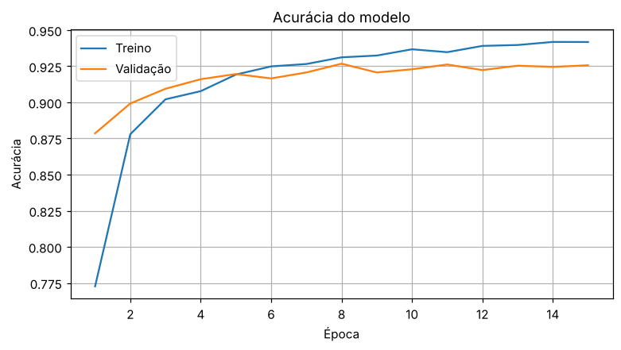

# 🍅 Detector de Doenças do Tomate com IA

Aplicação web que identifica doenças em folhas de tomate a partir de uma foto, usando visão computacional.

**👉 Teste o app:** LINK_DO_APP

## O problema

Doenças foliares causam perdas importantes na produção de tomate. Identificar o problema cedo ajuda o produtor a agir rápido e reduzir o uso desnecessário de defensivos.

## A solução

Um modelo de deep learning que analisa a foto de uma folha e indica se ela está saudável ou qual das doenças mais comuns é mais provável, com o percentual de confiança e as outras possibilidades.

## Resultado

- **Acurácia na validação:** 92,6% (3.632 imagens que o modelo nunca viu no treino)
- **Classes:** 10 (9 doenças + folha saudável)
- **Imagens usadas:** 18.160 fotos de folhas de tomate



## Como foi feito

1. **Dados:** dataset público PlantVillage, filtrado para as imagens de tomate.
2. **Modelo:** transfer learning com a MobileNetV2 pré-treinada no ImageNet. A rede base fica congelada e só a camada final é treinada para as 10 classes.
3. **Treino:** 80% das imagens para treino e 20% para validação. O passo a passo está no notebook [`detector_doencas_tomate.ipynb`](detector_doencas_tomate.ipynb), que roda no Google Colab.
4. **App:** interface em Streamlit, publicada no Streamlit Community Cloud.

## Tecnologias

Python · TensorFlow/Keras · Streamlit · Google Colab

## Limitações e próximos passos

- O PlantVillage tem fotos de laboratório, com fundo simples. Fotos tiradas no campo podem ter acurácia menor.
- Próximos passos: fazer fine-tuning das últimas camadas da rede, treinar com imagens reais de campo, incluir outras culturas (soja, milho, café) e criar uma versão para celular.

## Rodar localmente

```bash
pip install -r requirements.txt
streamlit run app.py
```

---
Feito por Victor Razzuli
